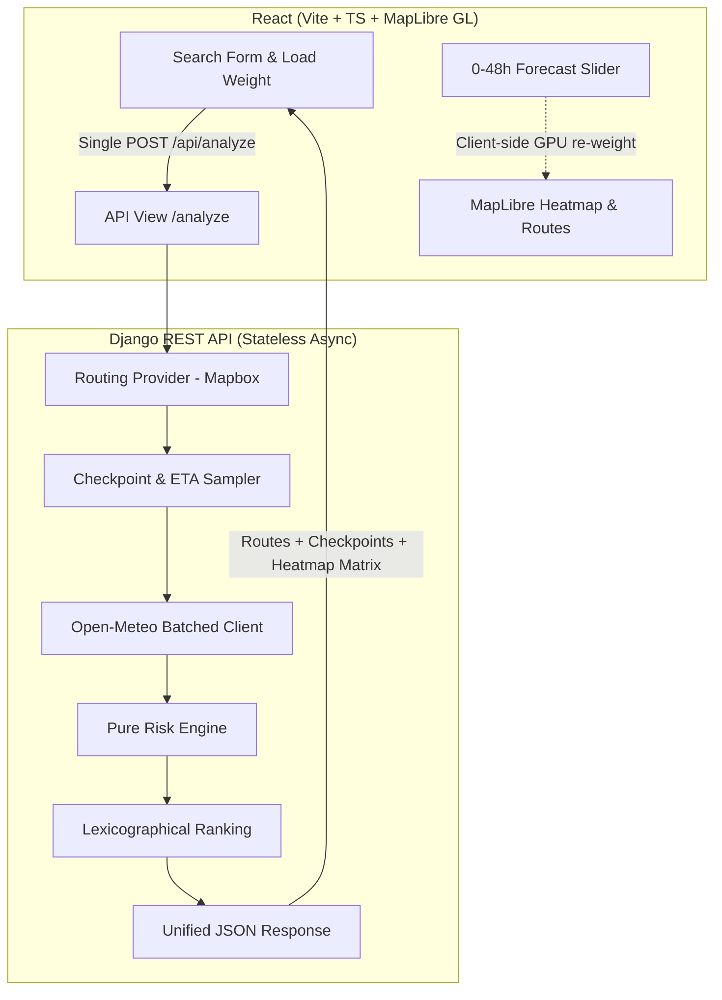

# Weather-Aware Truck Routing: Master Implementation Plan

> **Objective:** Build a fast, lightweight, high-performance decision-support web application (React + Django) that assists truck drivers in selecting the safest route based on real-time weather forecasts, truck load weight, and travel time.

---

## 1. Selected Third-Party APIs & Tech Stack

| Component | Choice | Rationale & Configuration |
| :--- | :--- | :--- |
| **Weather** | **Open-Meteo** | Free, zero-key setup, supports multi-location batching (`latitude=..&longitude=..`), provides hourly forecasts up to 48h+, and natively returns `wind_speed_unit=mph` and `precipitation_unit=inch`. |
| **Routing** | **Mapbox Directions API** (with pluggable `RoutingProvider` interface / GraphHopper fallback) | Supports `alternatives=true`, delivers clean GeoJSON polylines, segment durations, and cumulative distances. |
| **Geocoding** | **Mapbox Geocoding API** | Clean integration with Mapbox token, autocompletion for US cities/addresses, debounce-friendly. |
| **Map Engine** | **MapLibre GL JS** | High-performance WebGL/GPU-rendered map, native support for GPU heatmap layers and dynamic vector line styling. |
| **Backend** | **Django + Django REST Framework** | Clean separation of business logic, async request aggregation (`httpx.AsyncClient` + `asyncio.gather`), stateless architecture (no unnecessary DB overhead). |
| **Frontend** | **React + Vite + TypeScript** | Type-safe, ultra-fast client-side state transitions, smooth scrubbing with zero network chatter for the 0–48h slider. |

---

## 2. Core Specification & Exact Business Rules

### A. Checkpoint Weather Classification Thresholds
Conditions at each checkpoint are evaluated against these strict cutoffs:

| Condition | Low | Moderate | High | Severe | No Travel |
| :--- | :---: | :---: | :---: | :---: | :---: |
| **Wind** | `< 25 mph` | `25 – 34.9 mph` | `35 – 44.9 mph` | `45 – 54.9 mph` | `≥ 55 mph` |
| **Rain** | `< 0.10 in/hr` | `0.10 – 0.249 in/hr` | `0.25 – 0.499 in/hr` | `0.50 – 0.999 in/hr` | `≥ 1.00 in/hr` |
| **Snow** | `< 0.5 in/hr` | `0.5 – 0.99 in/hr` | `1.0 – 1.99 in/hr` | `2.0 – 2.99 in/hr` | `≥ 3.0 in/hr` |

*Baseline risk level* = `max(risk(wind), risk(rain), risk(snow))`.

### B. Weight & Load Adjustments
Load weight escalates the risk rating:
- **Wind ≥ 55 mph:** $\rightarrow$ **No Travel** (applies to all loads).
- **Wind 45–54 mph AND load > 30,000 lb:** $\rightarrow$ **No Travel**.
- **Wind 35–44 mph AND load > 40,000 lb:** $\rightarrow$ **Severe** (escalated if baseline was High or lower).

### C. Mile Attribution & Aggregation
- Checkpoints sample every $N$ miles ($N \in \{10, 25, 50\}$, auto-selected by route length with manual user override).
- Each checkpoint represents the segment distance surrounding it (midpoint segment partition), yielding:
  - `severe_miles`: Total miles under Severe conditions.
  - `high_miles`: Total miles under High conditions.
  - `no_travel_miles`: Total miles flagged as No Travel.
  - `avg_risk`: Mile-weighted risk score ($1 = \text{Low}, 2 = \text{Mod}, 3 = \text{High}, 4 = \text{Severe}, 5 = \text{No Travel}$).

### D. Strict Recommendation Priority (Lexicographical Sort)
1. **Fewest Severe Miles** (routes with `no_travel_miles > 0` disqualified or placed at bottom).
2. **Fewest High Miles**.
3. **Lowest Average Risk**.
4. **Shortest Travel Time** (duration tie-breaker).

---

## 3. Architecture & Data Flow

### Zero-Chatter Slider Principle
A single `POST /api/analyze` request returns:
1. Complete geometry and metrics for all 3 routes.
2. Checkpoint ETAs, sampled weather conditions, and risk ratings.
3. Recommended route with explanatory badges.
4. **48-Hour Corridor Heatmap Grid**: Lat/lon grid points along the trip corridor with an array of 48 hourly risk values. The React frontend updates the MapLibre heatmap layer instantaneously on slider movement via `setPaintProperty` without making subsequent network calls.

---

## 4. Phased Implementation Roadmap

- [x] **Phase 1: Project Setup & Pure Risk Engine**
  - [x] Setup isolated Python virtual environment inside `backend/` with `requirements.txt`.
  - [x] Implement `risk/thresholds.py`: Wind, rain, snow classification with half-open intervals.
  - [x] Implement `risk/classify.py`: Load adjustments (30k lb, 40k lb, 55+ mph) and multi-hazard combination.
  - [x] Implement `risk/aggregate.py`: Checkpoint-to-mileage attribution, severe/high miles, and weighted average risk.
  - [x] Implement `risk/recommend.py`: Strict lexicographical route ranking and explainable recommendation reasons.
  - [x] Unit test suite (`backend/tests/test_risk_engine.py`) with 36/36 passing boundary & logic tests.
  - [x] Initialize stateless Django project with DRF, CORS, LocMemCache, and `/api/health/`.
  - [ ] Initialize React project (Vite + TS + modern CSS + Lucide icons).

- [x] **Phase 2: Routing & Weather Pipeline (Backend)**
  - [x] Implement `RoutingProvider` interface with Mapbox Directions adapter (requesting alternatives).
  - [x] Build waypoint offset fallback if Mapbox provides fewer than 3 natural alternatives (ensures 3 distinct routes).
  - [x] Implement `checkpoint_sampler.py` to interpolate coordinates and precise ETAs along route geometry at 10/25/50 mile intervals with tests.
  - [x] Implement `weather_provider.py` with batched Open-Meteo requests, hourly cache, and ETA nearest-hour matching.
  - [x] Build corridor grid extractor for the 0–48h forecast matrix.
  - [x] Wire `/api/analyze/`, `/api/geocode/`, and `/api/health/` endpoints with complete integration test suite.

- [x] **Phase 3: Frontend Core & Map Visualization**
  - [x] Trip input form: Origin/Destination autocomplete, departure datetime picker, load weight, and sampling interval toggle.
  - [x] Setup MapLibre GL JS map instance with dark/clean vector tiles.
  - [x] Render 3 route polylines color-coded by segment risk, highlighting the recommended route.
  - [x] Render interactive checkpoint markers with rich popups (ETA, Wind, Rain, Snow, Risk Level).
  - [x] Route comparison cards displaying distance, duration, severe miles, high miles, avg risk, and "Recommended" banner with reasoning.

- [x] **Phase 4: 0–48h Weather Corridor Heatmap & Performance Polish**
  - [x] Add MapLibre GPU heatmap layer bound to the corridor weather matrix.
  - [x] Build interactive 0–48h time slider with smooth scrubbing, play/pause animation, and current forecast timestamp.
  - [x] Graceful edge-case handling (all routes have No Travel, API rate limits, mountain pass weather extremes).

- [ ] **Phase 5: Final Verification, Production Packaging & Walkthrough Prep**
  - [ ] End-to-end integration test with real US cross-country route scenarios (e.g., Denver to Chicago in winter storms).
  - [ ] Setup WhiteNoise for single-port deployment or Docker / production serve configuration.
  - [ ] Write comprehensive `README.md` documenting architecture, assumptions, exact boundary cutoffs, and run instructions.
  - [ ] Prepare bulleted script for 5–10 min Loom walkthrough.
